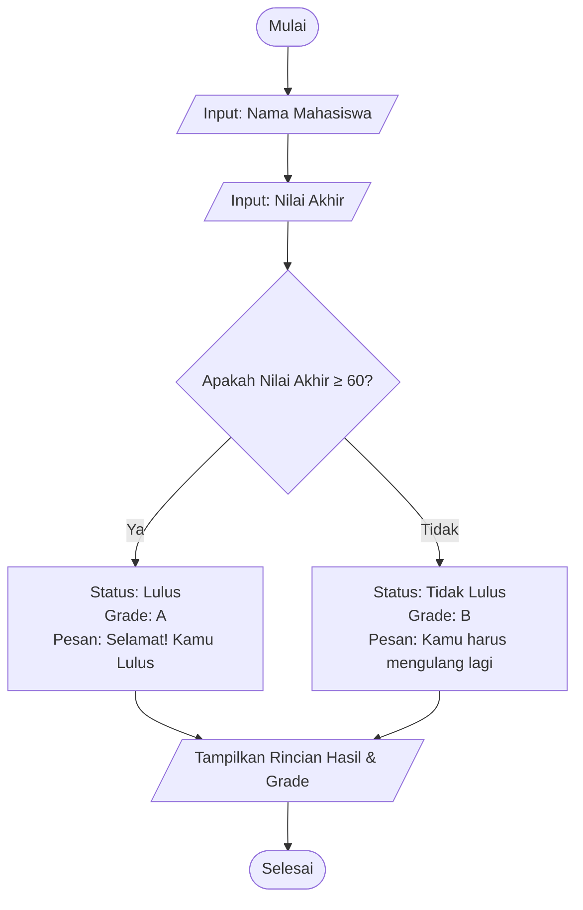

# Laporan Praktikum Modul 1: Percabangan Dasar & Input/Output


---

## 📖 Deskripsi Studi Kasus
Pada modul praktikum ini, dibuat sebuah program sederhana berbasis Python bernama **Program Cek Kelulusan Mahasiswa**. Program ini dirancang untuk memproses data input berupa nama mahasiswa dan nilai akhir (skala 0–100), kemudian melakukan evaluasi kondisi untuk menentukan status kelulusan mahasiswa berdasarkan aturan penilaian kampus.

---

## 🎯 Aturan & Ketentuan Penilaian

Sistem menentukan status kelulusan dengan kriteria sebagai berikut:

| Rentang Nilai Akhir | Status Kelulusan | Grade | Pesan Sistem |
| :---: | :---: | :---: | :--- |
| **$\ge$ 60** | **Lulus** | `A` | *Selamat! Kamu Lulus* |
| **$<$ 60** | **Tidak Lulus** | `B` | *Kamu harus mengulang lagi* |

---

## 🔄 Alur Program (Flowchart)



---

## 💻 Implementasi Kode (`studi_kasus.py`)

Berikut adalah kode sumber program yang diimplementasikan pada file [`studi_kasus.py`](studi_kasus.py):

```python
print("==== SISTEM PENENTUAN KELULUSAN MHS =====")

nama = str(input("Masukkan Nama : "))
nilai_akhir = int(input("Masukkan Nilai Lu : "))

print("Namamu :", nama)
print("Nilai Akhir :", nilai_akhir)

if nilai_akhir >= 60:
    print("Selamat! Kamu Lulus")
    status = "Lulus"
    grade = "A"
else: 
    nilai_akhir < 60
    print("Kamu harus mengulang lagi")
    status = "Tidak lulus"
    grade = "B"
    
print("Lu dapet Grade", grade)
print("==== Sampai Jumpa Lagi Bro ====")
```

### 🔍 Penjelasan Komponen Kode:
1. **Input & Konversi Tipe Data**:
   - `input("Masukkan Nama : ")` menerima input berupa teks (string).
   - `int(input("Masukkan Nilai Lu : "))` mengubah input angka menjadi tipe data integer agar dapat diperbandingkan secara matematis.
2. **Struktur Kontrol `if-else`**:
   - Menyeleksi apakah `nilai_akhir >= 60`. Jika bernilai `True`, blok `if` dijalankan. Jika `False`, blok `else` dijalankan.
3. **Penyajian Output**:
   - Menampilkan status keberhasilan, pesan pendukung, serta nilai grade yang diperoleh.

---

## 🧪 Hasil Uji Coba (Testing)

### Kasus 1: Nilai Memenuhi Syarat Kelulusan ($\ge 60$)
- **Input:**
  - Nama: `Sinta`
  - Nilai Akhir: `72`
- **Output Terminal:**
  ```text
  ==== SISTEM PENENTUAN KELULUSAN MHS =====
  Masukkan Nama : Sinta
  Masukkan Nilai Lu : 72
  Namamu : Sinta
  Nilai Akhir : 72
  Selamat! Kamu Lulus
  Lu dapet Grade A
  ==== Sampai Jumpa Lagi Bro ====
  ```

---

### Kasus 2: Nilai Tidak Memenuhi Syarat Kelulusan ($< 60$)
- **Input:**
  - Nama: `Budi`
  - Nilai Akhir: `50`
- **Output Terminal:**
  ```text
  ==== SISTEM PENENTUAN KELULUSAN MHS =====
  Masukkan Nama : Budi
  Masukkan Nilai Lu : 50
  Namamu : Budi
  Nilai Akhir : 50
  Kamu harus mengulang lagi
  Lu dapet Grade B
  ==== Sampai Jumpa Lagi Bro ====
  ```

---

## 🚀 Cara Menjalankan Program

1. Buka terminal dan arahkan ke direktori modul:
   ```bash
   cd modul1
   ```

2. Jalankan script Python:
   ```bash
   python3 studi_kasus.py
   ```

3. Masukkan data nama dan nilai sesuai instruksi yang muncul di layar.

---

## 📌 Kesimpulan
Berdasarkan praktikum Modul 1 ini:
- Program berhasil menerima masukan nama dan nilai akhir, lalu mengonversinya ke tipe data yang sesuai (`str` dan `int`).
- Struktur percabangan `if-else` berhasil mengevaluasi nilai akhir mahasiswa sesuai ketentuan (nilai $\ge 60$ dinyatakan lulus, sedangkan $< 60$ dinyatakan tidak lulus/mengulang).
- Hasil evaluasi dan grade ditampilkan secara interaktif di konsol.
